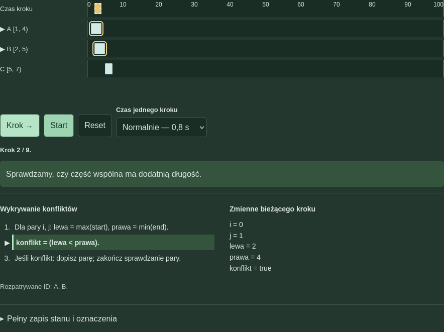
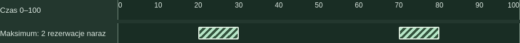

# Rezerwacje sali

## ASD1-M1-17 — Przedziały i zdarzenia na osi czasu

Autor: Deividas Dirma
Numer indeksu: 93791
Przedmiot: Algorytmy i struktury danych I
Rok akademicki: 2026/2027
Data: 26 października 2026 r.

## O czym jest projekt

Program pomaga zrozumieć algorytmy działające na przedziałach czasu. Rezerwacje jednej sali są przykładem zastosowania. Każda rezerwacja ma początek i koniec. Na ich podstawie można znaleźć nakładające się pary, połączyć zajęte odcinki i sprawdzić, ile rezerwacji występuje jednocześnie. Aplikacja pokazuje także kolejne kroki obliczeń.

Nie jest to pełny system rezerwacji. Nie obsługuje kont, dat ani kalendarza. Oś 0–100 oznacza umowne jednostki czasu. Dzięki temu przykłady można sprawdzić na kartce i porównać z widokiem programu.

## Podstawa opracowania

Dokumentacja opisuje kod z paczki ASD1-M1-17-MAKSIMUM.zip i wymagania dołączonej karty [1]. Pracowano na rozpakowanej kopii. Podczas tego opracowania agent nie zmieniał kodu aplikacji ani prezentacji. Zrzuty oraz wyniki oznaczone jako nowe pochodzą z uruchomienia tej kopii przez agenta 26.10.2026 r. Szczegóły zapisano w weryfikacja/dokumentacja/WYNIKI-NOWE.json [4].

## Jak czytać dokumentację

Strony 2–4 wyjaśniają założenia, algorytmy i koszty. Strony 5–7 opisują uruchomienie, budowę i obsługę. Strony 8–9 przedstawiają porównanie metod oraz testy. Strona 10 zawiera wnioski, podział wkładu, informacje o AI i źródła.

Pomoc AI jest opisana jawnie. Autorowi nie przypisano napisania kodu ani wykonania testów agenta. Publikacja GitHub i przekazanie linku w Dzienniku nie są potwierdzone. Materiały nie stanowią potwierdzenia zakończenia wszystkich formalności oddania.

<!-- PAGE -->

# 2. Cel, zakres i założenia

## Cel i odbiorca

Celem jest pokazanie, jak program analizuje przedziały czasu. Odbiorcą jest student poznający pętle, sortowanie i zdarzenia. Może przewidzieć następny krok, sprawdzić zmienne i zobaczyć przyczynę decyzji. Program odpowiada na trzy różne pytania: które pary się nakładają, kiedy sala jest zajęta i ile rezerwacji jest naraz.

## Przedziały półotwarte

Zapis [start,end) oznacza przedział półotwarty: początek należy do niego, a koniec już nie. Dla [1,4) chwila 1 jest w środku, ale chwila 4 nie jest. Dlatego [1,4) i [4,7) nie mają konfliktu. Ich pokrycie, czyli łączny zajęty odcinek, można jednak połączyć w [1,7). Nie ma między nimi przerwy.

Tabela 1. Ograniczenia wejścia i ich znaczenie.

| Dane | Warunek |
| --- | --- |
| Liczba przedziałów | Od 0 do 30; pusta lista jest dozwolona |
| Granice czasu | Liczby całkowite: 0 ≤ start < end ≤ 100 |
| Identyfikator ID | Niepusty napis bez skrajnych spacji; każdy ID unikalny |
| Formularz | Nadaje ID automatycznie; przy edycji ID pozostaje ten sam |

## Co zostało wykonane

W menu jest pięć metod: konflikty, łączenie pokrycia, zdarzenia początku i końca, maksimum oraz kontrola jednostka po jednostce. Dostępne są trzy scenariusze: prosty przykład ze stykiem, zagnieżdżenia z identycznymi granicami i dwa oddzielne okresy maksimum. Można dodawać, edytować i usuwać rezerwacje.

Sterowanie obejmuje Krok, Start/Pauzę, Reset i trzy tempa. Obok osi są opis kroku, pseudokod i zmienne. Rozwijane sekcje zawierają pełny stan, końcowy wynik, trzy pytania oraz porównanie i testy. Co najmniej jedno pytanie korzysta z bieżącego stanu.

Główna oś pokazuje krok animacji. Osobna oś w „Wyniku końcowym” zaznacza wszystkie odcinki największego obciążenia. Dane pozostają tylko w pamięci strony. Aplikacja nie obsługuje granic ułamkowych, zapisu na dysku ani zdarzeń cyklicznych.

<!-- PAGE -->

# 3. Algorytmy i warunki działania

## Konflikty: które pary się nakładają?

znajdzKonflikty sprawdza każdą parę raz, dla i < j. Liczy lewa=max(początków) i prawa=min(końców). Konflikt zachodzi, gdy lewa < prawa, czyli część wspólna ma dodatnią długość. Przy równości jest tylko styk. Dla A=[1,4) i B=[2,5) otrzymujemy lewa=2, prawa=4 i konflikt na [2,4). Wynik zawiera ID obu rezerwacji oraz wspólny odcinek.

## Pokrycie i sortowanie przez wstawianie

polaczPrzedzialy sortuje kopię danych po początku. Własny Insertion Sort wybiera kolejny element i wstawia go w uporządkowaną część tablicy, przesuwając większe wartości w prawo. Następnie program skanuje przedziały. Gdy start ≤ koniec ostatniego wyniku, łączy odcinki. Nowy koniec to max(stary koniec,end), aby zagnieżdżenie nie skróciło pokrycia. Przy przerwie dopisuje nowy odcinek. Na końcu sumuje długości end−start. Pokrycie nie zachowuje informacji o osobnych ID.

## Zdarzenia i największa liczba rezerwacji naraz

obliczZdarzenia tworzy (start,+1) i (end,−1). sortujZdarzenia używa Insertion Sort: najpierw porządkuje czas, a przy remisie ustawia −1 przed +1. Zmienna aktywne zmienia się po każdym zdarzeniu. Obciążenie [czas,następny czas) jest jednak zapisywane dopiero po całej grupie tej samej chwili. Przejściowy licznik wewnątrz grupy nie opisuje osobnego odcinka czasu.

obliczMaksimumZdarzeniami przekazuje te obciążenia do znajdzMaksimum. Większy wynik zastępuje poprzednie odcinki. Równy dodatni wynik dopisuje kolejny odcinek. Sąsiadujące odcinki są scalane, rozłączne pozostają osobno. Dla pustych danych wynikiem jest 0 i pusta lista.

## Kontrola jednostka po jednostce

obliczJednostkami dla t=0…99 sprawdza każdy przedział warunkiem start ≤ t < end. Zapisuje obciążenia 100 jednostek i skanuje je pomocnikiem maksimum. Metoda jest dokładna dla całkowitych granic: w środku [t,t+1) nic się nie zaczyna ani nie kończy. Nie jest ogólną metodą dla granic ułamkowych.

Pary konfliktów i maksimum aktywnych to różne wyniki. Cztery identyczne przedziały dają 6 konfliktujących par, ale tylko 4 rezerwacje naraz. Dla A=[1,4), B=[2,5), C=[5,7) jest jedna para A–B, pokrycie [1,7) długości 6 i maksimum 2 na [2,4) [1,4].

<!-- PAGE -->

# 4. Dane, stan i złożoność

## Jak zapisane są dane

Wejście jest tablicą obiektów {id,start,end}. Tablica to lista wpisów, a obiekt przechowuje pola jednego wpisu. Zdarzenie ma {id,czas,zmiana}. Odcinek obciążenia ma {start,end,aktywne}. Wynik maksimum zawiera liczbę i listę odcinków. Takie struktury wystarczają przy limicie 30 rezerwacji i pozwalają łatwo śledzić indeksy pętli.

Sortowanie pracuje na kopiach. Zapisy historii sortowania również dostają kopie tablic, więc późniejsze przesunięcia nie zmieniają wcześniejszych stanów. Stan interfejsu tworzą m.in. przedzialy, edytowanyIndeks, krokiAnimacji, numerKroku i zegarAnimacji. −1 oznacza brak edycji lub kroku, a null brak działającego zegara. Wpis historii ma postać {etap,stan}.

Tabela 2. Koszt obliczeń bez walidacji, historii i rysowania.

| Metoda | Czas | Pamięć |
| --- | --- | --- |
| Konflikty | Θ(n²): n(n−1)/2 par | O(1) pracy; do O(n²) wyniku |
| Insertion Sort kopii | O(n²); najlepiej O(n) | O(n) na kopię |
| Pokrycie z sortowaniem | O(n²); sam skan O(n) | O(n) |
| Zdarzenia i maksimum | O((2n)²+2n)=O(n²) | O(n) |
| Sam skan maksimum | O(k), k odcinków | Do O(k) wyniku |
| Jednostki, U=100 | Θ(Un+U) | O(U) |

Złożoność opisuje, jak rośnie koszt wraz z liczbą danych, a nie liczbę milisekund. n oznacza liczbę przedziałów, k liczbę badanych odcinków, U liczbę jednostek. O(n²) to koszt co najwyżej kwadratowy w tym modelu. Metoda zdarzeń nie ma tu kosztu O(n log n), ponieważ korzysta z Insertion Sort.

## Osobne koszty interfejsu

Walidacja ma O(n²), bo unikalność ID jest sprawdzana przez porównania z wcześniejszymi wpisami. Lista błędów wymaga O(n) pamięci przy stałym rozmiarze pól. Historia konfliktów ma O(n²) wpisów, a jednostek O(Un+U). Historia sortowania może mieć O(n²) zapisów z kopią O(n), czyli do O(n³) czasu i pamięci.

Rysowanie jednej osi przechodzi po n rezerwacjach i najwyżej dwóch wyróżnianych ID, więc ma O(n) pracy. Wypisanie stanu sortowania też może mieć O(n) danych. Cały pokaz ma do O(n³) pracy związanej z zapisami i wyświetlaniem. Zegar jedynie odtwarza przygotowaną historię. Te koszty nie są częścią liczników porównania algorytmów.

<!-- PAGE -->

# 5. Technologie i uruchomienie

## HTML, CSS i JavaScript

HTML określa treść strony: formularz, przyciski, tabele i rozwijane sekcje. CSS ustala układ, kolory oraz wygląd osi. JavaScript sprawdza dane, wykonuje algorytmy i odświeża ekran. Nie ma frameworka, serwera ani bazy danych. Badane algorytmy są zapisane w kodzie projektu, a nie zastąpione gotową biblioteką.

DOM to reprezentacja elementów strony dostępna dla JavaScript. Na przykład getElementById znajduje pole po ID, createElement tworzy nowy element, a textContent wpisuje tekst. addEventListener przypisuje funkcję do kliknięcia lub zmiany pola. Nazwy rezerwacji są wstawiane jako tekst, nie jako kod HTML [2].

## Uruchomienie lokalne

1. Rozpakuj całą paczkę do zwykłego folderu.
2. Otwórz index.html w przeglądarce, nie bezpośrednio w ZIP.
3. Zostaw pliki CSS i JavaScript obok HTML.
4. Aby sprawdzić algorytmy, otwórz tests.html.

Aplikacja działa bez internetu, kont i instalowania zależności. Otwiera lokalne pliki. Po odświeżeniu wraca pierwszy scenariusz i znikają własne dane. Reset to inna czynność: cofa tylko animację i nie usuwa rezerwacji ani końcowego wyniku.

## Odtwarzanie kroków

setInterval uruchamia wykonajKrok co określony czas. clearInterval zatrzymuje kolejne wywołania. Dostępne odstępy to 2 s, 0,8 s i 0,2 s. Pauza zachowuje pozycję. Krok zatrzymuje automatyczne odtwarzanie i przechodzi o jeden zapis. Zmiana tempa podczas odtwarzania tworzy zegar z nowym odstępem. Przeglądarka może opóźniać jego wywołania; nie jest to pomiar szybkości algorytmu.

## Co sprawdzono przy opracowaniu

Agent uruchomił kopię przez file:// w Firefoxie 151.0.2 headless, czyli bez widocznego okna. Sterowanie odbywało się przez WebDriver. HTTP i HTTPS skierowano na zamknięty lokalny port proxy. To praktyczna kontrola pracy bez dostępu WWW, nie analiza ruchu sieciowego. Nie sprawdzono fizycznego Maca, telefonu, Safari, Chrome ani pełnej obsługi czytnika ekranu.

Edytowalne źródło dokumentacji utworzono w DOCX narzędziem python-docx. PDF wyeksportowano przez LibreOffice. Są to narzędzia przygotowania materiałów, nie zależności aplikacji [5].

<!-- PAGE -->

# 6. Architektura i przepływ danych

Tabela 3. Rola plików w aktualnej aplikacji.

| Plik | Za co odpowiada |
| --- | --- |
| algorithms.js | Walidacja, kopie, sortowanie i wszystkie obliczenia |
| script.js | Formularz, scenariusze, lista danych, wyniki i osobna oś maksimum |
| animation.js | Przygotowanie i odtwarzanie historii, bieżąca oś, zmienne i pseudokod |
| education.js | Pytanie o licznik aktywne w aktualnym kroku i ocena odpowiedzi |
| comparison.js | Generator danych 5/15/30 i oddzielne liczniki operacji |
| tests.html, tests.js | Strona testowa oraz wejścia, oczekiwania i wyniki |

## Od formularza do wyniku

Formularz → kopia danych → sprawdzDane → zatwierdzenie listy → odswiezWidok → obliczenia → widok i przygotowanie historii. Program najpierw bada kopię, więc błędny zakres nie zastępuje poprawnych danych. Dodanie, edycja, usunięcie i wczytanie scenariusza korzystają ze wspólnego odświeżenia.

Algorytmy nie pobierają wartości z formularza i nie rysują strony. Dostają tablicę i zwracają wynik. Dzięki temu tests.html korzysta z tych samych funkcji co aplikacja. Skrypty są na końcu HTML, w kolejności algorithms, animation, education, comparison, script. Elementy strony istnieją już podczas rejestracji obsługi zdarzeń.

## Wynik końcowy i historia to nie to samo

odswiezWidok liczy konflikty, pokrycie i maksimum bez historii. Funkcja pokazOsMaksimum rysuje odcinki zwrócone przez obliczMaksimumZdarzeniami. Nie zgaduje ich z aktualnego koloru pasków. Każdy zakres ma opis tekstowy oraz opis paska. Kreskowanie uzupełnia kolor.

przygotujAnimacje wywołuje wybraną metodę z argumentem true. Włącza to zapis faktycznych operacji. Odtwarzacz dopisuje nazwę etapu i pokazuje stan, zamiast wykonywać drugą wersję algorytmu. Całe obliczenie historii kończy się przed odtwarzaniem; Pauza nie zatrzymuje pętli w środku liczenia. Reset zatrzymuje zegar i ustawia numerKroku na −1.

## Zakres obecnej aktualizacji

Historia i pliki potwierdzają pomoc agenta w przygotowaniu aplikacji, uproszczeniu widoku i dodaniu osobnej osi maksimum. W tym opracowaniu zmieniono tylko dokumentację i README oraz dodano dowody kontroli. Kod i wszystkie formaty prezentacji zachowano bez zmian. Starsze raporty opisują wcześniejsze uruchomienia, nie nowe sprawdzenia.

<!-- PAGE -->

# 7. Obsługa i aktualny interfejs

Wybierz przykład i kliknij Wczytaj. W „Edytuj dane” dodawaj, zmieniaj lub usuwaj przedziały. Wybierz metodę i użyj Krok albo Start. Pauza zachowuje pozycję, a Reset cofa animację. Tempo określa odstęp między krokami. Zatwierdzenie nowych danych rozpoczyna nowy przebieg. Znak ▶ i obramowanie wskazują badane rezerwacje.

Rozwiń „Wynik końcowy”, aby zobaczyć odpowiedź dla całych danych. Kreskowane paski z rys. 2 nie przedstawiają aktualnego kroku, lecz wszystkie okresy końcowego maksimum. Dla pustej listy nie ma pasków. Reset animacji nie usuwa tej osi.

„Pełny zapis stanu i oznaczenia” zawiera dodatkowe dane kroku. W „3 pytania” dwa pytania mają gotowe wyjaśnienia. Trzecie sprawdza wartość aktywne z bieżącego zapisu. Przy zdarzeniach może to być licznik częściowy przed końcem grupy czasu, a przy jednostkach przed sprawdzeniem wszystkich rezerwacji. „Porównanie i testy” zawiera liczniki i osadzoną stronę testów. Na wąskim ekranie oś wymaga przewijania poziomego.

<!-- PAGE -->

# 8. Porównanie metod maksimum

## Dane i sposób porównania

Agent ponownie uruchomił porownajMetody dla 5, 15 i 30 przedziałów. Generator tworzy dla i=0…n−1: start=(17i+7) mod 90 i end=start+1+(11i+3) mod (100−start). Są to osobne dane, niezależne od formularza. Obie metody uruchomiono bez historii. Pełne wejścia i liczniki zawiera WYNIKI-NOWE.json [4].

Tabela 4. Nowe wykonanie: wynik i główne liczniki.

| n | Maks. obu | Por. sort. | Przes. sort. | Zdarzenia | Sprawdzenia jednostek |
| --- | --- | --- | --- | --- | --- |
| 5 | 2 | 11 | 2 | 10 | 500 |
| 15 | 8 | 184 | 156 | 30 | 1500 |
| 30 | 15 | 856 | 798 | 60 | 3000 |

Tabela 5. Przygotowanie i skan wyniku; liczniki oddzielne.

| n | Tworzenie / kopie | Wstawienia | Skan zdarzeń | Zapis / skan jednostek |
| --- | --- | --- | --- | --- |
| 5 | 10 / 10 | 9 | 9 | 100 / 100 |
| 15 | 30 / 30 | 29 | 24 | 100 / 100 |
| 30 | 60 / 60 | 59 | 46 | 100 / 100 |

## Co oznaczają liczniki

Przetworzenie zdarzenia to jedna zmiana aktywne, razem 2n. Sprawdzenie jednostkowe to jeden warunek start ≤ t < end, razem 100n. Porównanie sortowania oznacza decyzję, czy przesunąć element. Przesunięcie to zapis w prawo, a wstawienie to zapis wybranego klucza po pętli. Tworzenie i kopiowanie liczą obiekty, skan maksimum liczy odcinki.

## Wyniki i ich znaczenie

Zgodziły się wartości oraz wszystkie odcinki: dla 5 przedziałów maksimum 2 na [58,67) i [75,95); dla 15 maksimum 8 na [75,83); dla 30 maksimum 15 na [60,61). To nie są liczby konfliktujących par.

Samych zdarzeń jest mniej niż sprawdzeń jednostek. Trzeba jednak doliczyć przygotowanie kolejności, zwłaszcza sortowanie. Insertion Sort ma tu najgorszy koszt O(n²). Nie wynika z tego, że metoda zdarzeń zawsze działa szybciej. Liczniki różnych operacji nie są czasem CPU i nie powinny być sumowane w fikcyjne milisekundy.

Walidacja, historia, rysowanie DOM i zegar są poza tym porównaniem. Obie metody używają wspólnej funkcji znajdzMaksimum. Sama ich zgodność nie wyklucza błędu tej funkcji, dlatego potrzebne są też konkretne oczekiwane wyniki. Starszy POROWNANIE.json ma te same główne wartości, ale jest materiałem historycznym, nie dowodem nowego wykonania.

<!-- PAGE -->

# 9. Testy i uzyskane wyniki

## Sprawdzenia wykonane przy tym opracowaniu

Agent otworzył tests.html z kopii przez file:// w Firefoxie 151.0.2. Strona pokazała 46 PASS i 0 FAIL. Zapisano też wejścia, oczekiwania i wyniki funkcji testowej. Osobno wykonano 16 kontroli interfejsu, wszystkie poprawne: m.in. pięć metod po jednym kroku, osie maksimum, dodanie, edycję, usunięcie, błędny zakres, Reset oraz Start/Pauzę. To nie są dodatkowe testy algorytmów [4].

Tabela 6. Wybrane przypadki z nowego wykonania. ID są różne.

| Wejście lub stan | Oczekiwany wynik | Uzyskany wynik |
| --- | --- | --- |
| [1,4),[2,5),[5,7) | 1 para; [1,7), długość 6; maks. 2 na [2,4) | Zgodne |
| [2,5),[5,8) | 0 par; [2,8), długość 6; maks. 1 na [2,8) | Zgodne |
| [0,10),[2,8),[3,4) | 3 pary; [0,10); maks. 3 na [3,4) | Zgodne |
| Dwa [2,5) | 1 para; maks. 2 na [2,5) | Zgodne |
| [10,30),[20,40),[60,80),[70,90) | Maks. 2 na [20,30) i [70,80) | Zgodne; 2 paski osi |
| Pusta lista [] | 0 par; brak pokrycia; maks. 0 i [] | Zgodne; brak pasków |
| start=end=4; także >30 wpisów | Błąd walidacji | Odrzucone |
| Para i=0,j=1 przykładu karty | lewa=2; prawa=4; konflikt=true | Zgodne w historii |
| [2,5),[5,8); chwila 5 | −1: 1→0; potem +1: 0→1 | Zgodne; po grupie 1 |
| Początki [8,1,4] | Po 1. wstawieniu [1,8,4] | Zgodne w historii |

## Zakres i granice kontroli

Testy obejmują wszystkie metody, walidację, granice 0 i 100, zagnieżdżenia, identyczne przedziały, puste dane, niezmienność wejścia i stany pośrednie. Wśród 46 pozycji są dwa testy zbiorcze: 1555 małych zestawów oraz 300 powtarzalnych wejść. Nie dopisuje się ich drugi raz jako 1855 nowych pozycji PASS. JSON zamienia NaN i Infinity na null; nazwane przypadki w tests.js zawierają właściwe wartości.

Raporty etapów i wcześniejsza kontrola 15/15 UI opisują poprzednie uruchomienia. Nie sumowano ich z nowymi wynikami ani nie przyjęto za potwierdzenie aktualnych zrzutów. Nowe testy zwiększają zaufanie, ale nie dowodzą poprawności dla wszystkich możliwych danych. Nie wykonano kontroli wszystkich przeglądarek ani fizycznego telefonu.

<!-- PAGE -->

# 10. Wnioski, wkład i źródła

## Wnioski i ograniczenia

Konflikt, pokrycie i maksimum odpowiadają na różne pytania. Warunek < wykrywa wspólny odcinek, a ≤ pozwala połączyć styk w pokryciu. Grupowanie zdarzeń zapobiega traktowaniu chwilowego licznika jako obciążenia odcinka. Końcowe maksimum zachowuje również rozłączne okresy. Oddzielna oś nie miesza wyniku z bieżącym krokiem.

Limit wynosi 30 przedziałów, granice są całkowite 0–100. Brakuje trwałego zapisu, dat i zdarzeń cyklicznych. Historia zwiększa zużycie pamięci. Ewentualny zapis danych byłby rozszerzeniem, a nie obecną funkcją.

## Wykorzystanie AI i własny wkład

Informacja podana przez autora: „Przy realizacji projektu korzystałem z agenta OpenClaw, do którego podłączony był Codex Sol 6.1 z ustawieniem rozumowania medium”. Nazwa konfiguracji i ustawienie rozumowania pochodzą od autora.

Agent pomagał przygotować kod, algorytmy, animacje, testy i materiały. Później upraszczał interfejs i dodawał wizualizację końcowego maksimum. Przy przeglądzie projektu i przygotowaniu wskazówek korzystano również z ChatGPT/Codex.

Potwierdzony wkład Deividasa Dirmy obejmuje określanie oczekiwań, wybór wyglądu i nazw, zgłaszanie uwag oraz zlecanie poprawek. Nie przypisuje się autorowi samodzielnego napisania kodu ani osobistego wykonania testów agenta. Nowe uruchomienia i zrzuty do tej dokumentacji wykonał agent.

Kontrola wyników AI polegała na porównaniu kodu z kartą, ustaleniu oczekiwanych odpowiedzi na konkretnych danych, sprawdzeniu stanów pośrednich, porównaniu obu metod i wykonaniu w przeglądarce. Wspólny pomocnik maksimum i ograniczony zakres testów nie pozwalają uznać tych kontroli za dowód dla wszystkich danych.

## Źródła i stan formalny

[1] Karta ASD1-M1-17, materialy/KARTA-ZADANIA.html — wymagania i przykład kontrolny.
[2] MDN Web Docs, https://developer.mozilla.org/ — JavaScript, DOM, setInterval i clearInterval.
[3] Princeton, Algorithms: https://algs4.cs.princeton.edu/25applications/ — źródło wskazane w karcie; obowiązuje wariant zadania.
[4] Kod z ASD1-M1-17-MAKSIMUM.zip oraz weryfikacja/dokumentacja/WYNIKI-NOWE.json — bezpośrednie źródła opisu i nowych wyników.
[5] Narzędzia dokumentacji: https://python-docx.readthedocs.io/ i https://www.libreoffice.org/.

Publikacja GitHub i przekazanie linku w Dzienniku nie są potwierdzone. Karta ich wymaga; nie wykonano ich w tej aktualizacji. Własna demonstracja i samodzielne wyjaśnienie kodu na obronie pozostają zadaniem autora.

<!-- PAGE -->
